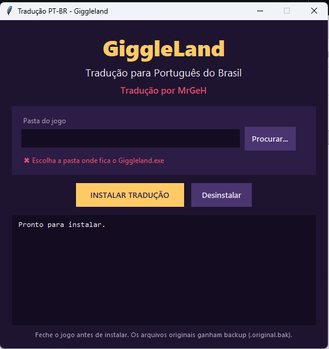

# Giggleland em Português (PT-BR) — Tradução completa

**Tradução PT-BR não oficial do jogo Giggleland**, feita por **MrGeH**.
Deixa o Giggleland em **português do Brasil**: menus, legendas, diálogos, notas, objetivos e créditos.

> 🇧🇷 Giggleland traduzido · Giggleland PT-BR · Giggleland em português · patch de tradução Giggleland · legendas em português
> 🇺🇸 *Giggleland Brazilian Portuguese translation (PT-BR) — fan-made translation patch*

  

---

## 📥 Download

**[⬇️ Baixar a última versão da tradução (Releases)](../../releases/latest)**

Baixe o arquivo `Giggleland_Traducao_PTBR.zip`.

---

## ✅ O que foi traduzido

São **1.705 textos traduzidos**:

- 🗨️ **Todas as falas e legendas**, inclusive as dos vídeos da TV e dos anúncios do parque
- 🎮 **Menus, configurações, controles, acessibilidade e avisos**
- 🎯 **Objetivos, capítulos e placas pelo cenário**
- 📓 **Notas e diários** do Terry e do Simon
- 🕹️ **Minigame "A Aventura do Eliot"** (versão arcade)
- 🎵 **Créditos e a cantiga final**

> As **vozes continuam em inglês**, mas todas as legendas aparecem em português.
> Nomes próprios (Eliot, Ella, Tolie, Rory, Teri...) foram mantidos como no original.

---

## 🛠️ Como instalar

1. **Feche o jogo.**
2. Extraia o `.zip` e coloque a pasta `TraducaoPTBR` dentro da pasta do Giggleland, onde fica o `Giggleland.exe`.
   Exemplo: `...\steamapps\common\Giggleland\TraducaoPTBR\`
3. Abra o **`Instalar_Traducao_PTBR_Giggleland.exe`**.
4. Confira a pasta do jogo e clique em **INSTALAR TRADUÇÃO**. O instalador tenta achar a pasta sozinho, inclusive nas bibliotecas da Steam.
5. Abra o jogo. Pronto! 🎉

O instalador **faz backup dos arquivos originais** antes de alterar qualquer coisa. Os backups ficam com o final `.original.bak`.

> ⚠️ O Windows pode mostrar o aviso do **SmartScreen**, porque o programa não tem assinatura digital.
> Clique em **"Mais informações" → "Executar assim mesmo"**.

### ❌ Como desinstalar

- Abra o instalador e clique em **Desinstalar**. Os arquivos originais voltam a partir do backup.
- Ou use, na Steam, **Propriedades → Arquivos instalados → Verificar integridade dos arquivos**.

### 🔄 O jogo atualizou e voltou para o inglês?

Rode o instalador de novo.
- Ele foi feito para se adaptar a novas versões do jogo.
- Textos novos que ainda não foram traduzidos aparecem em inglês.
- Se a atualização mudar demais o jogo, o instalador **avisa e não altera nada**.

---

## ❓ Perguntas frequentes

**O Giggleland tem português oficial?**
Não. O jogo foi lançado apenas em inglês. Esta é uma tradução feita por fã.

**Por que o jogo não tinha opção de idioma?**
O jogo já tem um sistema de idiomas por dentro, mas o código vinha travado em inglês. A tradução adiciona o **Português (Brasil)** como novo idioma e libera essa trava.

**Funciona na versão da Steam?**
Sim. O instalador só altera os arquivos do jogo que já está instalado no seu computador.

**Tem vírus?**
Não. O código-fonte completo do instalador está neste repositório, na pasta [`instalador/`](instalador/).

---

## 🧩 Como funciona (para curiosos e desenvolvedores)

O Giggleland é feito em **Unity (IL2CPP)**. A tradução mexe em três arquivos:

| Arquivo | O que muda |
|---|---|
| `Giggleland_Data/resources.assets` | Adiciona o idioma `pt-BR` à tabela de localização do jogo (`LocalizationData`). O inglês original fica intacto. |
| `GameAssembly.dll` | Altera 9 bytes no `LocalizationManager` (`Awake` e `SetLanguage`), que forçavam o idioma `"en"`. |
| `Giggleland_Data/StreamingAssets/en.csv` | Traduz textos antigos de interface. |

Arquivos deste repositório:

- `instalador/instalador_gui.py`: a janela do instalador (tkinter)
- `instalador/instalar_traducao.py`: a lógica de instalação. Ela procura a tabela e o trecho de código por padrão, em vez de usar posições fixas.
- `instalador/locdata.py`: leitura e escrita da tabela `LocalizationData`
- `instalador/traducao.json`: as traduções, ligadas a cada chave e ao texto original em inglês
- `instalador/csv_pt.json`: as traduções do `en.csv`

Encontrou um erro de tradução ou um texto em inglês? Abra uma **[issue](../../issues)**!

---

## ⚖️ Aviso

Esta é uma **tradução de fã, não oficial e gratuita**. Ela não tem nenhuma ligação com os desenvolvedores do Giggleland.
Este repositório **não contém arquivos do jogo**: o instalador apenas modifica a cópia que você já tem.
**Giggleland** e todos os seus direitos pertencem aos seus criadores. **Compre o jogo e apoie os desenvolvedores!**

---

**Tradução por MrGeH** 💜
